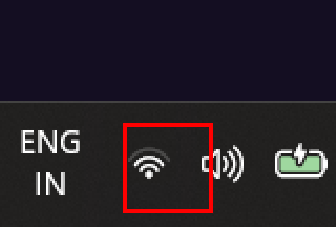

# Architecture

```
addon/globalPlugins/labelade/
  __init__.py      NVDA glue: events, commands, settings panel, Tools menu
  core/            plain Python, no NVDA imports, fully unit tested
    heuristics.py  which names count as "no name"; parsing and cleaning model replies
    imaging.py     BGRX pixels → PNG, red box, difference hash, capture sizing
    store.py       labels per app as JSON; label pack validation, import, export
    client.py      Lemonade Server client on urllib; model selection
    prompts.py     the two prompts: label a control, describe a region
    labeller.py    Labeller (model calls) and Worker (one background thread)
tests/             unit tests, NVDA stubs, plugin tests
tools/             mock Lemonade server, add-on builder
scripts/           label pack validator (CI)
schema/            label-pack.schema.json
packs/             community label packs
```

## Flow

1. **Focus event.** `event_gainFocus` runs before NVDA speaks the new focus. Labelade checks the role (button, link, graphic, tab, menu item, and similar) and whether the name is useless: empty, the role word, a file or resource name, a GUID or a lone symbol (`heuristics.needs_label`).
2. **Lookup.** It looks in the store for the control by automation id (`uia:` from UI Automation, `ia2:` from a web page's DOM id). If there's none, it captures the control at 36×32 pixels, trims the edges where focus rings change, and computes a 64-bit difference hash. A stored hash within 6 bits counts as the same control. On a match, it sets `obj.name` (NVDA allows overriding the property by assignment) and NVDA speaks the label as if the app had provided it.
3. **Request.** Otherwise it captures the control with surroundings of 1.5 times its size, using `screenBitmap`, which stretches small regions up to at least 336 pixels so a 4B model can see the icon. The worker thread draws a red box round the control, encodes a PNG and calls Lemonade.
   This is what the model receives for a 40-pixel tray icon, captured from a real screen through the add-on's own pipeline:

   

4. **Answer.** The model returns `{"label", "confidence"}`. `parse_label` strips reasoning blocks, accepts JSON buried in chatter, falls back to the first line (marked low confidence) and rejects "unknown", the role word and names that are themselves junk. The result is queued back to NVDA's main thread, saved and spoken, but only if the user is still on that control.

## Decisions

- **NVDA add-on, not a separate app.** Blind users already have a screen reader with their voice, speed and keys set up. A second program that also talks would fight it. Inside NVDA, labels show up everywhere names do: focus, object navigation, and lists of elements.
- **Pure-Python core.** NVDA add-ons can't install packages, and NVDA ships no imaging library. PNG encoding and hashing are about 100 lines using `zlib` and slicing, so the add-on is one small file with no native code.
- **Two ways to recognise a control.** Automation ids are exact and portable between computers, but many apps don't set them, so the image hash covers the rest. Web frameworks that generate ids on each load (such as React `:r3:`, `ember123` or long digit runs) are ignored, because those ids would never match again.
- **The user outranks the AI.** `store.put` refuses to replace a `user` label with an `ai` or `pack` one. Unsure labels are spoken as unsure. A wrong label read with confidence is worse than none.
- **No data loss.** Saves are atomic (`os.replace`). A corrupt file is renamed to `.corrupt` instead of being overwritten. One bad entry doesn't discard the rest of the file.
- **Never block NVDA.** All model calls run on one background thread. Duplicate requests for the same control are dropped. A description cancels queued labels, because the user is waiting for it. After "can't reach Lemonade", auto-labelling stays quiet for a minute instead of interrupting every Tab press.
- **Private.** Labelade captures only the region it needs, only on a command or on focus of an unlabelled control, and never on secure screens (`globalVars.appArgs.secure`). Settings warn if the server address isn't on this computer.

## Talking to Lemonade

| Call | Use |
|---|---|
| `GET /api/v1/models` | Downloaded models and their `labels`. Labelade keeps those labelled `vision`. |
| `GET /api/v1/health` | `all_models_loaded`. A vision model that's already loaded is preferred, so nothing has to be swapped. |
| `POST /api/v1/chat/completions` | OpenAI-style messages with an `image_url` data URI. `temperature: 0`, `max_tokens: 64` for labels, and `enable_thinking: false` (a Lemonade extension). |

If no model is set, the choice order is: a loaded vision model, then Qwen3-VL-4B-Instruct, Qwen3.5-4B, Gemma-4-E4B, Gemma-3-4b, Qwen3.5-2B, Ministral-3-3B, then any vision model. After an error the choice is made again, in case the model was deleted.
